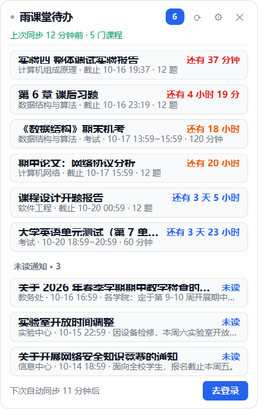
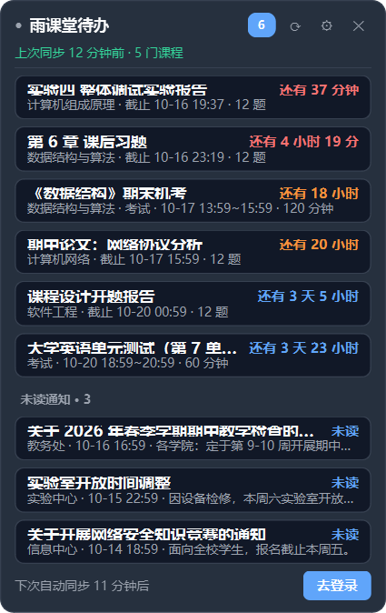
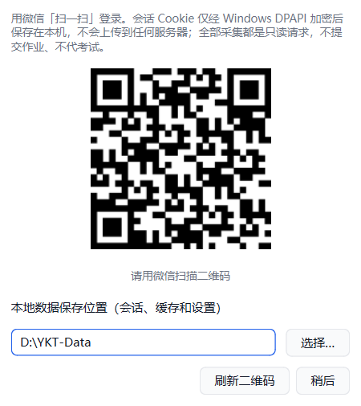

# 雨课堂小助手

一个只读的 Windows 桌面小程序：定时抓取**雨课堂**网页端的待办作业与课程公告，在桌面留一张
悬浮清单，并在截止前后按档弹系统通知提醒。

> 全程**只读**：只调用"查列表"这类浏览接口，不提交作业、不答题、不刷课、不签到，
> 也不会在服务端做任何写操作。

本项目由 [xxt-assistant](https://github.com/led629263224-cmyk/xxt-assistant)（学习通小助手）
改造而来：保留其界面、提醒引擎、SQLite 存储、DPAPI 加密与打包脚本，把平台数据层换成雨课堂
（`xxt/rainclass/`），登录方式从"账号密码"换成"微信扫码"。

> ⚠️ 上游仓库**没有附 LICENSE**。本改造版仅供个人与同学间学习交流使用，请勿商用；
> 若上游日后补上许可证，以该许可证为准。

## 界面预览

<table>
  <tr>
    <td></td>
    <td></td>
    <td></td>
  </tr>
  <tr>
    <td align="center">浅色主题</td>
    <td align="center">深色主题</td>
    <td align="center">微信扫码登录</td>
  </tr>
</table>

> 预览图由 `tools/preview_card.py` 用**写死的演示数据**渲染：课程名和作业名都是编的，
> 二维码是本地生成的占位图（扫不出任何内容）。重新生成：`.venv\Scripts\python.exe tools\preview_card.py`

---

## 一、功能

| 功能 | 说明 |
| --- | --- |
| 桌面悬浮清单 | 无边框圆角卡片，可拖动，位置自动记忆；高度随条数自适应，超出的部分在卡片里滚动；默认不置顶，可在设置里勾上 |
| 只看没做完的 | 已过期、已提交的一律不占地方：列表只按**截止时间**从近到远排未完成作业 |
| 右键滑动移除 | 按住某条待办的右键，将鼠标拖出整个卡片的左侧或右侧边缘后松手，才会动画移出；窗口内松手一律回弹。只在本机隐藏，可在设置里恢复 |
| 桌面常驻 | 独立透明浮窗：从其他应用按 Win+D 回到桌面时显示，切回应用后恢复普通层级；主动收起到托盘后保持隐藏 |
| 自定义背景 | 设置 → 界面选择背景图，自动居中裁剪到圆角卡片；可调文字保护蒙层，也可恢复纯色背景 |
| 数据目录 | 首次登录前可选择本地数据文件夹；设置 → 维护可迁移位置或清除全部本地数据 |
| 倒计时分级配色 | 剩余 >24h 蓝、≤24h 橙、≤6h 红 |
| 提醒分级 | 新作业/新公告；截止前 24h / 6h / 1h 各提醒一次；同一档只响一次，跨档后才补下一次 |
| 免打扰 | 默认 23:00–7:00 不弹窗，安静时段照样同步；此时只有 ≤1 小时的加急提醒会弹 |
| 公告与平台消息 | 抓每门课的未读公告，有未读时显示在列表底部（可关） |
| 托盘常驻 | 托盘图标右键：显示/隐藏、立即同步、登录/重新登录、打开雨课堂、设置、退出 |
| 微信扫码登录 | 卡片或托盘点「去登录」，弹出二维码，用手机微信扫一扫即可；不用把账号密码交给程序 |
| 会话安全 | 本地只保存登录后的会话（cookie），用 Windows DPAPI（当前用户）加密后存 `data/session_cookies.json` |
| 单实例 | 重复启动只会唤起已有实例 |
| 不误触 | 卡片上的条目点了没有反应，不会弹出浏览器 |
| 开机自启 | 设置里一键开关，写注册表 `HKCU\...\CurrentVersion\Run` |
| 抓取克制 | 默认 30 分钟一次、请求间隔 0.7 秒、串行、带随机抖动 |

## 二、安装

### 方式一：直接用打包好的 exe（推荐，同学拿到就能用）

把 `ykt-assistant-v0.1.0.exe` 放到桌面或任意普通文件夹，双击即可，**不需要装 Python**。
同目录的 `ykt-assistant-usage.txt` 是给同学看的三步说明。

> 首次运行 Windows 可能提示"已保护你的电脑"，点「更多信息」→「仍要运行」即可（exe 未购买数字签名）。
> 别放 `C:\Program Files`，那里没有写权限。

### 方式二：从源码跑（想改代码或自己打包）

需要 **Python 3.10+**（本次开发使用 3.13）。在源码目录执行：

```powershell
python -m venv .venv
.venv\Scripts\python.exe -m pip install -i https://pypi.tuna.tsinghua.edu.cn/simple -r requirements.txt
```

> 国内直连 PyPI 很慢甚至超时，建议带上清华镜像参数 `-i https://pypi.tuna.tsinghua.edu.cn/simple`。

## 三、使用

1. 启动程序（在源码目录下执行命令）：

   - `.venv\Scripts\pythonw.exe -m xxt.main` —— 无控制台窗口，日常使用
   - `.venv\Scripts\python.exe -m xxt.main` —— 带控制台看日志，排错用
2. 点击卡片上的「去登录」，首次登录时先确认或选择**本地数据保存位置**，
   然后用手机**微信扫一扫**弹出的二维码，在手机上确认登录。
   登录成功后立即开始同步，卡片逐门课程显示进度，无需收起再打开。
   （二维码约 5 分钟失效，过期后对话框会自动换一张。）
3. 卡片上的 `⟳` 立即同步、`⚙` 打开设置、`✕` 收起到托盘（不是退出）。
   条目**左键点击不做任何事**；**按住右键水平滑动**，鼠标越过整个卡片的左边缘或右边缘后松手才移除，窗口内松手回弹。
   列表超出一屏时用滚轮滚动。
4. 退出：托盘图标右键 → 退出。

### 命令行（排错用）

```powershell
.venv\Scripts\python.exe -m xxt.main --sync-once    # 不开界面同步一次并打印清单
.venv\Scripts\python.exe -m xxt.main --reset        # 清除本地会话，回到未登录
.venv\Scripts\python.exe -m xxt.main --tray         # 只留托盘不弹窗口（开机自启用）
.venv\Scripts\python.exe tools\test_notify.py       # 自测提醒：先推演规则，再真弹系统通知
```

> 日志里每条同步会带 `提醒 N`，`data\app.log` 里还能看到 `已弹提醒[h1]：…` 这样的记录，
> 方便确认提醒到底发没发。

## 四、目录结构

```
xxt/
  config.py           配置读写（含 platform.host）
  crypto.py           Windows DPAPI 封装（加密本地会话）
  store.py            SQLite 存储与增量 diff
  notify.py           提醒规则引擎（分档、去重、免打扰）
  sync.py             采集编排 + 后台定时线程
  startup.py          开机自启（注册表）
  main.py             入口（GUI / 无界面命令）
  rainclass/          雨课堂数据层
    endpoints.py        URL 构造（纯函数）
    models.py           Course / Activity / Exam / Notice 数据模型
    parse.py            JSON 解析（纯函数，可离线单测）
    datetimes.py        时间工具（纯函数）
    login.py            微信扫码状态机（echallenge / 轮询 / 回调）
    client.py           会话、限速、登录态探测、四个业务取数方法
  ui/
    widget.py           悬浮清单
    dialogs.py          扫码登录 / 设置对话框
    tray.py             托盘图标与气泡通知
    style.py            浅色/深色配色
    desktop.py          Win32 桌面常驻
run.py                直接运行 / PyInstaller 打包入口
tools/                预览图、界面自检、提醒自测、打包脚本
tests/                pytest 测试（数据层全部离线可跑，见下）
data/                 运行时数据：ykt.db / session_cookies.json / app.log
```

## 五、数据来源（实测结论）

平台侧的接口形态决定了这个程序的能力边界，这里如实写清楚：

| 数据 | 来源 | 说明 |
| --- | --- | --- |
| 课程列表 | `GET /v2/api/web/courses/list?identity=2` | 一次返回全部学期；默认只取最新学期 |
| **待办作业** | `GET /v2/api/web/logs/learn/{classroom_id}?actype=-1` | **一次拿到标题、类型、截止时间（毫秒）、完成状态**，不需要课程签名、不需要逐个进详情页 |
| 课程公告 | `GET /v/discussion/v2/announcements/` | 按课程抓 |
| 平台消息 | `GET /c27/online_courseware/ykt/system_message/` | 首页红点 |
| 考试 | `GET /api/v3/classroom/on-lesson-upcoming-exam` | **只有"课中即将开始的考试"**，通常为空；雨课堂学生端没有课后考试清单接口 |

几个由此而来的限制，别踩坑：

- **"学习日志"页是唯一可靠的待办来源。** 雨课堂课程页那个"未完成(N)"角标背后不是列表接口
  （它只返回一个总数），真正的内容在 `logs/learn` 里。
- **没有课后考试清单。** 如果你的课程有线上考试，本程序**抓不到**，请以雨课堂 App/网页为准。
- **请求都带 `xtbz: ykt` 头**；`logs/learn` 等接口在已登录会话下裸调即通，不需要 CSRF token。
- **域名因校而异。** 雨课堂按学校独立部署，如果你的学校不是 `www.yuketang.cn`，
  请在设置或 `config.json` 里把 `platform.host` 改成你学校的地址（形如 `https://xxx.yuketang.cn`）。
- **登录态约两周过期。** 过期后卡片会提示"登录已失效"，点「去登录」重新扫码即可。
- **接口随时可能变更。** 解析逻辑集中在 `xxt/rainclass/parse.py`，URL 构造集中在
  `xxt/rainclass/endpoints.py`，改起来比较集中。

## 六、设置项

设置窗口分四个标签页：

- **同步**：自动同步间隔（分钟）、请求限速（秒/请求）。
- **提醒**：总开关、截止提醒档位（默认 `24,6,1` 小时）、免打扰时段、新作业/新公告提醒开关。
- **界面**：窗口置顶（**默认关闭**，需要时自己勾上）、深色主题、在列表底部显示未读公告、卡片不透明度、开机自启、背景图及文字保护蒙层。
- **维护**：显示登录状态并可一键退出登录；显示"已从列表移除 N 项"，可一键恢复被移除的条目；打开数据目录。
  可更改数据存放位置，保存后自动迁移；「清除全部本地数据」经确认后退出登录，清理本地会话、缓存、待办、背景图和设置，并关闭开机自启。
  清理前会等待当前请求结束，不会删除所选文件夹中的其他文件，也不影响雨课堂服务器上的内容。

选择自定义位置后，项目目录只保留 `storage.json` 作为位置记录，`config.json` 和运行数据位于所选目录。
背景图会复制为数据目录中的 `background.png`，原图移动或删除不影响已保存的背景。

> 也可以直接编辑根目录的 `config.json`（改完重启程序生效）。

## 七、开发与测试

数据层（`rainclass/` 的 endpoints / models / parse / datetimes / login）**不依赖网络和 GUI**，
全部用固定时钟与脱敏 fixture 覆盖：

```powershell
.venv\Scripts\python.exe -m pytest tests -q
```

`tests/fixtures/` 里的 JSON 都是从真实响应**脱敏**后留下的（课程名、ID、姓名全部替换为假数据），
因此可以放心提交。请求层（`client.py`）的登录态探测与错误映射也有单测。

改界面时可以用：

```powershell
.venv\Scripts\python.exe tools\preview_card.py    # 把界面渲染成 docs/ 下的预览图
.venv\Scripts\python.exe tools\smoke_ui.py        # 界面自检（右键移除、恢复、排序等）
```

## 八、打包成 exe

在源码目录里一条命令即可（脚本会自动带上图标、排掉用不到的 Qt 模块）：

```powershell
.venv\Scripts\python.exe -m pip install pyinstaller
.venv\Scripts\python.exe tools\build_exe.py
```

产物是 `dist\ykt-assistant-v0.1.0.exe`（单文件，约 50 MB，同学拿到不用装 Python）。
`dist\ykt-assistant-usage.txt` 是给同学看的说明，可以一起发出去。

几个已经处理好的点：

- `xxt/config.py` 的 `_base_dir()` 会识别冻结场景：打包后 `config.json` 和 `data\`
  都在 **exe 同目录**下，所以放在桌面或任意普通文件夹就能用（别放 `C:\Program Files`，
  那里没有写权限）。
- 图标来自 `assets\icon.png`，用 `tools\make_icon.py` 生成多尺寸 `icon.ico`；想换图标
  就替换这张图再跑一次它。
- `run.py` 兜住了未捕获的异常：写 `data\crash.log` 并弹框提示，因为 `-w` 打包后没有控制台。
- 日志在任何情况下都会写 `data\app.log`。

## 九、常见问题

**Q：二维码扫了没反应？**
确认手机微信登录的就是你自己的雨课堂账号；扫码后需要在手机上点"确认登录"。
二维码约 5 分钟失效，等待对话框自动换一张即可。

**Q：提示"登录已失效"？**
雨课堂会话约两周过期。点卡片右下角的「去登录」重新扫码。

**Q：某个作业的截止时间显示"未知"？**
接口没给 `score_deadline` 时程序会如实显示未知，不影响其他条目。

**Q：抓不到考试？**
雨课堂学生端没有课后考试清单接口，这不是 bug，见上面「数据来源」一节。

**Q：会不会被封号？**
程序只读、低频（默认 30 分钟一次）、串行限速，与正常浏览行为接近。但**请勿**把间隔改得
过小或频繁手动同步；本项目不做任何提交、答题、刷课、签到动作。

**Q：卡片不见了？**
它在托盘里。右键托盘图标 → 显示任务清单。
Windows 使用独立浮窗保持透明背景正常绘制。按 Win+D 显示桌面时卡片会显示，切回普通应用后可被应用覆盖。
勾选「窗口始终置顶」会切换到应用前方显示的模式。主动收起到托盘后不会因为 Win+D 自动出现。

## 十、说明

- 本项目为个人学习/效率工具，改造自 [xxt-assistant](https://github.com/led629263224-cmyk/xxt-assistant)；
  登录流程参考了第三方 SDK [RainClassSDK](https://github.com/Auto-CQUPT-Plan/RainClassSDK)（MIT）的公开结论，
  未引入其任何代码或依赖。
- 与雨课堂官方无关。接口随时可能变更；请遵守学校与平台的使用规定，仅用于管理自己的待办。
